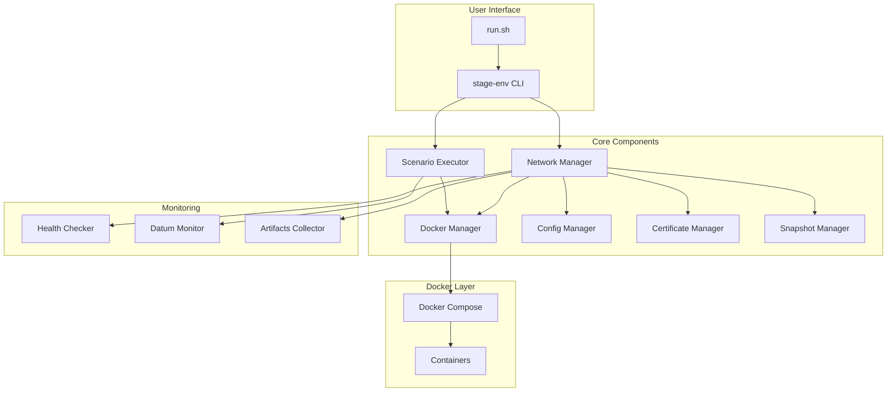
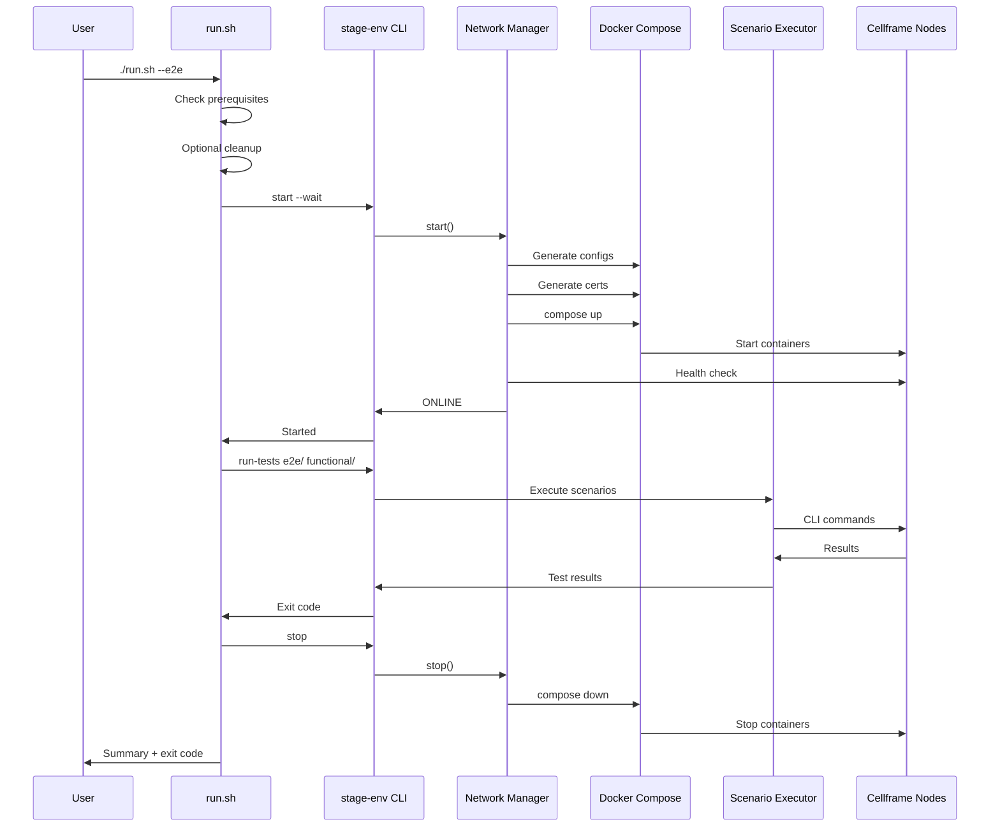

# Stage Environment Architecture

**Internal architecture and components of the stage-env testing system**

---

## 📖 Contents

1. [Overview](#overview)
2. [System Architecture](#system-architecture)
3. [Core Components](#core-components)
4. [Data Flow](#data-flow)
5. [Python Modules](#python-modules)
6. [Scenario Language Implementation](#scenario-language-implementation)
7. [Docker Integration](#docker-integration)
8. [Snapshot System](#snapshot-system)
9. [Monitoring & Health](#monitoring--health)

---

## Overview

Stage Environment is a Python-based CLI system for managing Docker-isolated testing environments for Cellframe Node.

### Technology Stack

- **Language:** Python 3.13+
- **CLI Framework:** Typer (built on Click)
- **Containerization:** Docker + Docker Compose V2
- **Validation:** Pydantic 2.x
- **Logging:** structlog
- **Async:** asyncio for asynchronous operations
- **HTTP Client:** httpx for RPC calls

### Key Principles

1. **Autonomy** - Fully self-contained system
2. **Portability** - Easy to move between environments
3. **Declarative** - Tests written in YAML without programming
4. **Isolation** - Each test/suite in clean Docker environment
5. **Fail-fast** - Errors should be explicit, no silent failures

---

## System Architecture



### Entry Points

#### 1. Bash Wrapper (`stage-env`)

**Purpose:** Activates venv, installs dependencies, launches Python CLI

**Features:**
- Automatic dependency installation
- Virtual environment management
- Argument forwarding to Python CLI

#### 2. Python CLI (`stage_env.py`)

**Framework:** Typer

**Main commands:**
- `start` - Start test network
- `stop` - Stop network  
- `restart` - Restart network
- `status` - Show network status
- `build` - Build cellframe-node artifacts
- `rebuild` - Rebuild Docker images and restart
- `run-tests` - Execute YAML test scenarios
- `logs` - Show node logs
- `exec` - Execute command in node
- `certs` - Generate certificates
- `clean` - Clean up artifacts and cache
- `pkgs-update` - Update packages in containers
- `kill` - Kill network gracefully (SIGTERM)
- `terminate` - Force terminate (SIGKILL)
- `snapshots-list` - List snapshots
- `snapshots-delete` - Delete snapshot
- `snapshots-info` - Snapshot details
- `snapshots-clean` - Clean old snapshots

**Command modules:**
- `src/cli/network_commands.py`
- `src/cli/test_commands.py`
- `src/cli/cert_commands.py`
- `src/cli/snapshot_commands.py`

---

## Core Components

### Network Manager

**Module:** `src/network/manager.py`  
**Class:** `NetworkManager`

**Responsibilities:**
- Docker Compose lifecycle management
- Network topology creation/deletion
- Node configuration generation
- Health-check monitoring
- Snapshot integration
- Log management and command execution

**Key methods:**
- `start()` - Start Docker Compose network
- `stop()` - Stop network (optional remove volumes)
- `restart()` - Restart entire network or specific node
- `rebuild()` - Full rebuild (cleanup + build + start)
- `get_status()` - Get network status
- `generate_node_configs()` - Generate NodeConfig for all nodes
- `create_clean_snapshot()` - Create clean state snapshot
- `restore_clean_state()` - Restore from snapshot
- `clean_test_data()` - Clean user data via docker exec
- `cleanup()` - Full cleanup (volumes, containers, artifacts)

**Genesis Versioning:**

Genesis scenarios are organized by Cellframe Node major version (`v5.x`, `v6.x`) under `scenarios/genesis/`. The `_detect_genesis_version()` method auto-detects the version from the DEB package filename (e.g. `cellframe-node-6.1-...` → `v6.x`). Default: `v6.x`.

### Scenario Executor

**Module:** `src/scenarios/executor.py`  
**Class:** `ScenarioExecutor`

**Responsibilities:**
- Execute CLI commands in Docker containers
- Execute RPC calls
- Execute Python/Bash code
- Manage RuntimeContext (variables)
- Apply hierarchical defaults
- Extract data from command output

**Step types supported:**
- `CLIStep` - cellframe-node-cli commands
- `ToolStep` - cellframe-node-tool commands
- `RPCStep` - JSON-RPC calls
- `PythonStep` / `PythonCheck` - Python code
- `BashStep` / `BashCheck` - Bash scripts
- `PrintStep` - Debug output with Jinja2 substitution
- `WaitStep` - Simple/polling waiting (duration, cli, bash, python, docker_exec, notify)
- `WaitForDatumStep` - Datum lifecycle monitoring
- `NetworkWaitStep` - Network state waiting
- `DockerExecStep` - Execute command in container (shorthand for docker_op exec)
- `DockerOpStep` - Docker operations (start/stop/restart/pause/unpause/logs/exec/cp)
- `DpkgStep` - DEB package install/remove
- `ConfigStep` - Config modifications (standard, cfg.d, template, deploy, param_map)
- `SnapshotStep` - Snapshot operations (create/restore/verify/delete)
- `MetricStep` / `MetricsTableStep` - Performance metrics recording and display
- `ForStep` - For loops with iteration
- `IfStep` - Conditional execution (if/then/else)
- `WhileStep` - While loops with max iterations
- `SwitchStep` - Switch/case statements
- `SetStep` - Variable assignment
- `StepGroup` - Group steps with local defaults (YAML keys: `group:` or `name:`)
- `CustomOperandStep` - User-defined operands loaded from `operands/` directories

**Integration:**
- Uses `CLICommandParser` for auto-adding CLI options
- Uses `DatumMonitor` for wait_for_datum
- Uses Docker client for exec commands

### Docker Compose Manager

**Module:** `src/docker/compose.py`  
**Class:** `DockerComposeManager`

**Responsibilities:**
- Manage docker-compose files
- Execute docker-compose commands
- Generate docker-compose.yml from topology
- Monitor container status
- Health checks and diagnostics
- Register root nodes in network

**Key methods:**
- `build()` - Build Docker images
- `generate_compose_for_nodes()` - Generate docker-compose.yml from NodeConfig[]
- `up()` - Run docker-compose up
- `down()` - Stop (with options: volumes, images)
- `ps()` - List containers
- `logs()` - Get container logs
- `exec()` - Execute command in container
- `wait_for_services()` - Wait for all nodes ready
- `get_service_status()` - Status of all services
- `is_running()` - Check if network is running
- `cleanup_stale_resources()` - Clean old containers/networks
- `add_extra_node_services()` - Add dynamically provisioned nodes (from `node_compose`)
- `pause()` / `unpause()` - Pause/unpause containers (for fault injection)

### Scenario Parser

**Module:** `src/scenarios/parser.py`  
**Class:** `ScenarioParser`

**Responsibilities:**
- Parse YAML scenarios
- Process includes (nested templates)
- Validate via Pydantic schemas
- Variable substitution

**Key methods:**
- `parse_scenario()` - Parse single scenario file
- `parse_suite()` - Parse suite descriptor
- `_process_includes()` - Deep merge includes (supports file paths and inline dict entries)
- `substitute_variables()` - Replace {{var}} placeholders

### Certificate Generator

**Module:** `src/certs/generator.py`  
**Class:** `CertGenerator`

**Responsibilities:**
- Generate node-addr.dcert for node identification
- Generate validator certificates for ROOT/MASTER nodes
- Build cert-generator Docker image
- Use cellframe-node-tool

**Naming convention:**
- Node cert: `node-addr.dcert`
- Validator cert: `stagenet.master.pvt.{index}.dcert`
- Validator address: `validator_addr.txt`

**Storage:** `/opt/cellframe-node/var/lib/ca/` (bind-mounted volume)

### Configuration Manager

**Module:** `src/config/loader.py`  
**Class:** `ConfigLoader`

**Responsibilities:**
- Load stage-env.cfg
- Load topology files
- Render Jinja2 templates
- Validate configurations

**Key methods:**
- `load_stage_config()` - Load stage-env.cfg to dict
- `load_topology()` - Load and validate topology
- `render_template()` - Render Jinja2 template
- `get_node_count()` - Count nodes in topology
- `list_topologies()` - List available topologies

---

## Data Flow

### Test Execution Flow



---

## Python Modules

### Directory Structure

```
src/
├── cli/                    # CLI commands
│   ├── network_commands.py  # start, stop, restart, status
│   ├── test_commands.py     # run-tests
│   ├── cert_commands.py     # certs
│   ├── snapshot_commands.py # snapshots
│   └── common.py            # Shared utilities
│
├── scenarios/              # Scenario system
│   ├── parser.py            # YAML parsing
│   ├── executor.py          # Execution engine
│   ├── schema.py            # Pydantic models (main)
│   ├── schema_control_flow.py # Set/If/While/For/Switch models
│   ├── schema_config.py     # ConfigStep model
│   ├── schema_dpkg.py       # DpkgStep model
│   ├── schema_operand.py    # CustomOperandStep model
│   ├── schema_metrics.py    # MetricStep/MetricsTableStep models
│   ├── extractors.py        # Data extraction
│   ├── validator.py         # Pre-execution validation
│   └── step/                # Step executors
│       ├── cli.py           # CLI step executor
│       ├── rpc.py           # RPC step executor
│       ├── python.py        # Python step executor
│       ├── bash.py          # Bash step executor
│       ├── wait.py          # Wait executor
│       ├── wait_for_datum.py # Datum monitoring
│       └── config.py        # Config step executor
│
├── network/                # Network management
│   ├── manager.py           # NetworkManager
│   ├── topology_builder.py  # Topology construction
│   ├── models.py            # NodeConfig, NetworkTopology
│   └── genesis*.py          # Genesis initialization
│
├── docker/                 # Docker integration
│   ├── compose.py           # DockerComposeManager
│   └── container.py         # Container operations
│
├── config/                 # Configuration
│   ├── loader.py            # ConfigLoader
│   ├── generator.py         # ConfigGenerator
│   └── manager.py           # ConfigManager
│
├── certs/                  # Certificates
│   └── generator.py         # CertGenerator
│
├── snapshots/              # Snapshot system
│   ├── manager.py           # SnapshotManager
│   ├── base.py              # BaseSnapshot
│   ├── recreate.py          # RecreateSnapshot
│   ├── filesystem.py        # FilesystemSnapshot
│   └── squashfs.py          # SquashfsSnapshot
│
├── monitoring/             # Monitoring
│   ├── health.py            # HealthChecker
│   ├── datum.py             # DatumMonitor
│   ├── manager.py           # MonitoringManager
│   ├── artifacts.py         # ArtifactsCollector
│   └── waiter/              # Various waiters
│
└── utils/                  # Utilities
    ├── cli.py               # CLI helpers
    ├── logger.py            # Logging setup
    ├── cli_parser.py        # CLICommandParser
    ├── report_generator.py  # Report generation
    └── artifacts.py         # Artifact management
```

### Key Classes

#### ScenarioExecutor

**Purpose:** Execute test scenarios step-by-step

**Runtime Context:** Manages variables, step results, summary

**Step execution pattern:**
```python
def _execute_step(self, step, ctx: RuntimeContext, defaults):
    # 1. Merge defaults
    effective_params = self._merge_defaults(step, defaults)
    
    # 2. Substitute variables
    substituted = self._substitute_in_step(effective_params, ctx)
    
    # 3. Execute based on type
    if isinstance(step, CLIStep):
        result = self._execute_cli_step(substituted, ctx)
    elif isinstance(step, WaitForDatumStep):
        result = self._execute_wait_for_datum_step(substituted, ctx)
    # ... etc
    
    # 4. Save results
    if step.save:
        ctx.set_variable(step.save, result)
    
    # 5. Apply wait
    if step.wait:
        self._wait_duration(step.wait)
```

#### DatumMonitor

**Purpose:** Background service monitoring datum lifecycle

**Lifecycle tracking:**
1. **0.5s** - Check mempool (fail-fast if not found)
2. **30-120s** - Wait for block inclusion
3. **60-180s** - Wait for network propagation

**States:**
- `NOT_FOUND` → `REJECTED` (fail fast)
- `IN_MEMPOOL` → `VERIFIED` → `IN_BLOCKS` → `PROPAGATED`

**Concurrency:** Can track multiple datums simultaneously

#### CLICommandParser

**Purpose:** Parse cellframe-node-cli help and auto-apply defaults

**Key methods:**
- `parse_cli_help()` - Parse help from running container
- `get_command_options()` - Get available options for command
- `has_option()` - Check if command supports option
- `apply_cli_defaults()` - Add missing options from defaults.cli

**Cache:** `cache/cli_commands.json`

**Example:**
```python
# defaults.cli = {"net": "stagenet"}
# command = "token list"
# Result: "token list -net stagenet" (if command supports -net)
```

#### SnapshotManager

**Purpose:** Fast test suite isolation via snapshots

**Implementations:**
- **recreate** - Full cleanup and recreation (~40s)
- **filesystem** - rsync copy (~3s create/restore)
- **squashfs** - Compressed read-only images (~2s restore, ~5s create)

**Benefits:** Reduces suite isolation time from 40s to 2-3s

---

## Scenario Language Implementation

### Schema Models

**Module:** `src/scenarios/schema.py`

**Main models:**
- `TestScenario` - Full test scenario
- `SuiteSetupScenario` - Lightweight suite setup
- `SuiteDescriptor` - Suite metadata (includes `node_compose`, `node_compose_gen`, `docker_compose`, `docker_compose_gen`, `env_file`)
- `NodeComposeSpec` - Dynamic node definition (id, role, source, packages, cap_add, docker_devices, environment, setup)
- `NodeComposeGenSpec` - Parametric node generator (prefix, count with `{{var}}` support)
- `DockerComposeGenSpec` - Parametric generation of non-cellframe containers (build, devices, volumes)
- `NetworkConfig` - Network configuration
- `NodeConfig` - Single node config
- `SectionConfig` - setup/test sections
- `CheckSectionConfig` - check section
- `StepDefaults` - Hierarchical defaults

**Step types:**
- `CLIStep`, `ToolStep`, `RPCStep`
- `PythonStep`, `BashStep`
- `WaitStep`, `WaitForDatumStep`
- `ConfigStep`, `DockerOpStep` (start/stop/restart/pause/unpause/logs/exec/cp), `SnapshotStep`
- `NetworkWaitStep`
- Control flow: `ForStep`, `IfStep`, `WhileStep`, `SwitchStep`

**Check types:**
- `CLICheck`, `RPCCheck`, `PythonCheck`, `BashCheck`

**Validation:** Pydantic model validators for complex checks

### Data Extraction

**Module:** `src/scenarios/extractors.py`  
**Class:** `DataExtractor`

**Extract types:**
- `wallet_address` - Cellframe wallet (base58, 75-105 chars)
- `node_address` - Node address (0x::format)
- `hash` - Hash (0x[hex]{64})
- `number` - Numeric values
- `token_name` - Token ticker
- `bool` - Boolean values
- `raw` - Arbitrary type

**Validation:**
- `wallet_address`: Base58 decode + SHA3-256 checksum
- `node_address`: Check :: separator format
- `hash`: Validate 0x[hex]{64} pattern

**Patterns:**
```python
WALLET_ADDRESS_PATTERN = r'^[A-Za-z0-9]{75,105}$'
NODE_ADDRESS_PATTERN = r'^[A-Fa-f0-9:]{10,}$'
HASH_PATTERN = r'^(0x)?[A-Fa-f0-9]{64}$'
```

### Hierarchical Defaults

**Levels (priority low to high):**
1. Global (`defaults:` at top level)
2. Section (`setup:`, `test:`, `check:` can have own defaults)
3. Group (`StepGroup` with local defaults)
4. Step (individual step params)

**Merge rules:**
- Scalar values: More specific level overrides
- `cli` dict: Deep merge (keys added/overridden)
- `None` values in includes: Don't override existing

**Example:**
```yaml
defaults:
  node: node1
  wait: 3s
  cli:
    net: stagenet

test:
  defaults:
    node: node2  # Overrides global node
    cli:
      token: TEST  # Merges with global cli.net
  steps:
    - cli: token list
      # Uses: node=node2, wait=3s, cli={net: stagenet, token: TEST}
```

---

## Docker Integration

### Docker Compose Generation

**Dynamic generation:** `docker-compose.yml` created from NodeConfig[]

**Node template:**
```yaml
services:
  node-{id}:
    image: cf-node:debug-latest
    container_name: cellframe-stage-node-{id}
    hostname: node-{id}
    networks:
      stagenet:
        ipv4_address: {ip}
    ports:
      - "{http_port}:8079"
      - "{rpc_port}:8545"
    volumes:
      - ./data/node-{id}:/opt/cellframe-node/var/lib
      - ./config/node-{id}:/opt/cellframe-node/etc
    environment:
      - NODE_ID={id}
      - NODE_ROLE={role}
```

### Networking

**Default subnet:** `172.20.0.0/16`  
**Base IP:** `172.20.0.10`  
**IP allocation:** Sequential (node-1: .10, node-2: .11, ...)

### Port Mapping

**Base ports (configurable):**
- HTTP: 8079
- RPC: 8545
- P2P: 31337
- CF: 7007

**Per-node increment:** node-{N} uses base_port + (N-1)

---

## Snapshot System

### Overview

**Purpose:** Fast test suite isolation

**Benefit:** Reduces clean state restoration from 40s to 2-3s

See Snapshot System section above for implementation details.

### Implementations

#### Recreate Mode
**Speed:** ~40s restore  
**Storage:** Minimal  
**Method:** Full cleanup and Docker restart

#### Filesystem Mode  
**Speed:** ~3s create/restore  
**Storage:** ~500MB  
**Method:** rsync directory copy  
**Dependencies:** rsync

**Key methods:**
- `_rsync_copy()` - Execute rsync with options
- `create()` - Copy data/ to snapshot/
- `restore()` - Copy snapshot/ to data/

#### SquashFS Mode
**Speed:** ~2s restore, ~5s create  
**Storage:** ~100MB compressed  
**Method:** Compressed read-only image + overlay  
**Dependencies:** squashfs-tools, overlayfs kernel support

**Key methods:**
- `create()` - Create .sqfs via mksquashfs
- `restore()` - Extract via unsquashfs + overlay mount

### Configuration

```ini
[suite_isolation]
mode = squashfs               # disabled/recreate/filesystem/squashfs
compression = gzip            # none/gzip/lzo/xz (for squashfs)
auto_create_on_startup = true # Create clean_state on network start
auto_cleanup = true           # Auto-delete old snapshots
keep_snapshot_count = 5       # How many to keep
```

---

## Monitoring & Health

### Health Checker

**Module:** `src/monitoring/health.py`  
**Class:** `HealthChecker`

**Checks:**
- Node HTTP availability (ping)
- CLI socket availability
- RPC endpoint responsiveness
- Log analysis for errors

**Health status:**
```python
class HealthStatus:
    is_healthy: bool
    http_ok: bool
    cli_ok: bool
    rpc_ok: bool
    errors: List[str]
```

### Datum Monitor

**Module:** `src/monitoring/datum.py`  
**Class:** `DatumMonitor`

**Purpose:** Background service tracking datum lifecycle

**Monitoring phases:**
1. **Mempool** (0.5s timeout) - Fast fail if rejected
2. **Verification** (30-120s) - Wait for inclusion in block
3. **Propagation** (60-180s) - Wait for network sync

**Usage in scenarios:**
```yaml
- cli: token_emit -token TEST -value 1000 -addr {{addr}} -certs test_cert
  save: tx_hash

- wait_for_datum: "{{tx_hash}}"
```

**Implementation:**
- Async monitoring loop
- Concurrent tracking of multiple datums
- Future-based results
- CLI command execution for status checks

### Artifacts Collector

**Module:** `src/monitoring/artifacts.py`  
**Class:** `ArtifactsCollector`

**Collects:**
- Node logs (from containers)
- Health check logs
- Core dumps
- Scenario execution logs
- System info
- Monitoring metrics

**Structure:**
```
artifacts/run_<timestamp>/
├── <test_type>/
│   └── <suite>/
│       ├── scenario-logs/
│       ├── node-logs/
│       ├── health-logs/
│       └── core-dumps/
└── summary.json
```

---

## Extension Points

### Adding New Step Type

1. **Define Pydantic model** in `src/scenarios/schema.py`:
```python
class MyCustomStep(BaseModel):
    my_custom: str
    node: str = "node1"
```

2. **Add to TestStep Union:**
```python
TestStep = Union[CLIStep, ..., MyCustomStep]
```

3. **Implement executor** in `src/scenarios/step/my_custom.py`:
```python
class MyCustomStepExecutor:
    def execute(self, step: MyCustomStep, ctx: RuntimeContext):
        # Implementation
        pass
```

4. **Register in ScenarioExecutor:**
```python
def _execute_step(self, step, ctx, defaults):
    if isinstance(step, MyCustomStep):
        return self.my_custom_executor.execute(step, ctx)
```

### Adding New Check Type

Same process, but use `CheckSpec` union instead of `TestStep`.

---

## See Also

- **[Run.sh Guide](RunShGuide.md)** - User guide for run.sh
- **[Scenarios Tutorial](scenarios/Tutorial.md)** - Learn scenario language
- **[Scenarios Glossary](scenarios/Glossary.md)** - Complete DSL reference
- **Source Code** - Python modules in `src/`

---

**Language:** English | [Русский](../ru/Architecture.md)

