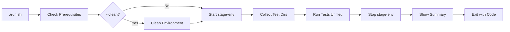

# Run.sh Guide - Unified Test Runner for Cellframe Node

**Complete guide for running E2E, Functional, and Regression tests**

---

## 📖 Contents

1. [Overview](#overview)
2. [Quick Start](#quick-start)
3. [Command Reference](#command-reference)
4. [Test Types](#test-types)
5. [Workflow](#workflow)
6. [Configuration](#configuration)
7. [CI/CD Integration](#cicd-integration)
8. [Troubleshooting](#troubleshooting)

---

## Overview

`run.sh` is a unified bash script for running all types of Cellframe Node tests. It provides a single entry point for:

- **E2E tests** - End-to-end scenarios in YAML
- **Functional tests** - Individual command testing
- **Regression tests** - Bug reproduction scenarios

### Key Features

- ✅ **Unified execution** - All test types in single run
- ✅ **Automatic environment** - Starts/stops stage-env automatically
- ✅ **Clean isolation** - Optional cleanup before tests
- ✅ **Comprehensive reports** - Artifacts collection and summaries
- ✅ **CI/CD ready** - Perfect for automated pipelines

### Location

```
cellframe-node/
└── tests/
    ├── run.sh              ← This script
    ├── stage-env/          ← Testing infrastructure
    ├── e2e/                ← E2E test scenarios
    ├── functional/         ← Functional tests
    └── regression/         ← Regression tests
```

---

## Quick Start

### Run All Tests

```bash
cd tests
./run.sh
```

This will:
1. Start stage-env network
2. Run all E2E, Functional, and Regression tests
3. Collect artifacts
4. Stop network
5. Show summary

### Run Specific Test Type

```bash
# Only E2E tests
./run.sh --e2e

# Only functional tests
./run.sh --functional

# Only regression tests
./run.sh --regression
```

### Run Specific Test Suite

```bash
# Single suite
./run.sh tests/e2e/token/

# Single scenario
./run.sh tests/e2e/token/001_token_decl.yml

# Multiple suites
./run.sh tests/e2e/token/ tests/functional/wallet/
```

---

## Command Reference

### Basic Commands

#### Run All Tests
```bash
./run.sh
```
- Runs: E2E + Functional + Regression
- Auto-starts network
- Auto-stops network after tests

#### Run E2E Only
```bash
./run.sh --e2e
```
- Tests: `stage-env/tests/base/` + `e2e/`
- Use case: End-to-end validation

#### Run Functional Only
```bash
./run.sh --functional
```
- Tests: `functional/`
- Use case: Command-level testing

#### Run Regression Only
```bash
./run.sh --regression
```
- Tests: `regression/`
- Use case: Bug verification

### Advanced Options

#### Clean Before Run
```bash
./run.sh --clean --e2e
```
- Cleans: cache, snapshots, volumes
- Use case: Fresh environment, troubleshooting
- Note: Does NOT rebuild cellframe-node (only cleans test env)

#### Rebuild Images
```bash
./run.sh --rebuild --e2e
```
- Rebuilds Docker images before starting
- Use case: After Dockerfile changes
- Note: Slower than normal start

#### Stop Environment
```bash
./run.sh --stop
```
- Only stops stage-env
- Doesn't run tests
- Use case: Cleanup after interrupted test

#### Update Packages
```bash
./run.sh --pkgs-update
```
- Updates cellframe-node binary in containers
- Runs `apt update && apt upgrade`
- Use case: Testing with latest packages

#### Help
```bash
./run.sh --help
```
- Shows all available options
- Provides usage examples

### Combining Options

```bash
# Clean, rebuild images, run E2E
./run.sh --clean --rebuild --e2e

# Run specific suite after cleanup
./run.sh --clean tests/e2e/token/
```

---

## Test Types

### E2E Tests (`tests/e2e/`)

**Description:** End-to-end scenarios testing complete workflows

**Format:** YAML scenarios

**Example structure:**
```
tests/e2e/
├── token/
│   ├── 001_token_decl.yml
│   ├── 002_token_emit.yml
│   └── 003_token_transfer.yml
├── wallet/
│   ├── 001_wallet_create.yml
│   └── 002_wallet_operations.yml
└── chain/
    └── ...
```

**Includes:** Base tests from `stage-env/tests/base/` (connectivity, health)

### Functional Tests (`tests/functional/`)

**Description:** Testing individual commands and features

**Format:** YAML scenarios

**Focus:** Single command behavior, edge cases

**Example:**
```yaml
name: Wallet List Command
description: Test wallet list output formats

test:
  - cli: wallet new -w test1
  - cli: wallet new -w test2
  - cli: wallet list
    contains: test1
    contains: test2
```

### Regression Tests (`tests/regression/`)

**Description:** Bug reproduction scenarios

**Format:** YAML scenarios

**Naming:** `test_bug_XXXXX.yml` (where XXXXX is issue number)

**Purpose:** Ensure fixed bugs don't reappear

**Example:**
```yaml
name: Bug #20138 - Transaction validation
description: Reproduce and verify fix for issue #20138

test:
  # Steps to reproduce bug
  - cli: ...
  
check:
  # Verify bug is fixed
  - cli: ...
    not_contains: "ERROR"
```

---

## Workflow

### Standard Workflow



### Detailed Steps

#### 1. Prerequisites Check
- Verifies Python3 installed
- Verifies Docker installed
- Exits if missing

#### 2. Optional Cleanup (`--clean`)
- Runs `stage-env clean --all`
- Removes snapshots (via Docker alpine)
- Cleans cache/data (via Docker alpine)
- Cleans cache/code (via Docker alpine)
- Removes .cache directory

**Why Docker alpine?** Container files are root-owned, Docker cleanup avoids `sudo`

#### 3. Start Network
```bash
./stage-env --config=../stage-env.cfg start --wait
```
- Builds images (if needed)
- Generates configs
- Generates certificates
- Starts containers
- Waits for all nodes ONLINE
- Creates clean_state snapshot (if configured)

With `--rebuild`:
```bash
./stage-env --config=../stage-env.cfg start --rebuild --wait
```

#### 4. Collect Test Directories

**Test directory collection logic:**
```bash
TEST_DIRS=()

if [ specific tests provided ]; then
    # Use user-provided specific paths
    TEST_DIRS=(user_provided_paths...)
else
    # Collect by type flags
    if --e2e:
        TEST_DIRS+=(stage-env/tests/base/ e2e/)
    if --functional:
        TEST_DIRS+=(functional/)
    if --regression:
        TEST_DIRS+=(regression/)
fi
```

**Important:** Paths are converted from `cellframe-node/` root to be relative to `stage-env/` directory

**Example conversion:**
- User specifies: `tests/e2e/` (relative to cellframe-node/)
- Converted to: `../e2e/` (relative to stage-env/)
- Tool used: `realpath --relative-to`

#### 5. Unified Test Execution

**Single run with all directories:**
```bash
./stage-env run-tests --no-start-network ${TEST_DIRS[@]}
```

**Benefits:**
- One `run_id` for all tests
- Single `artifacts/` directory
- Unified report
- Network started once (faster)

#### 6. Stop Network
```bash
./stage-env stop
```
- Stops all containers
- Removes containers
- Preserves volumes (unless `--volumes` used)

#### 7. Summary
- E2E Tests: PASSED/FAILED
- Functional Tests: PASSED/FAILED  
- Regression Tests: PASSED/FAILED
- Exit code: 0 if all passed, 1 if any failed

---

## Configuration

### Stage-env Config

**Location:** `tests/stage-env.cfg`

**Key sections:**

```ini
[network]
name = stagenet
network_id = 0x1234
consensus_type = esbocs

[topology]
root_nodes_count = 3
master_nodes_count = 3
full_nodes_count = 1

[node_source]
type = local
local_path = ../test_build/cellframe-node.deb

[paths]
cache_dir = ../testing/cache
artifacts_dir = ../testing/artifacts

[timeouts]
startup = 600
health_check = 600
command = 30

[suite_isolation]
mode = squashfs
auto_create_on_startup = true
```

### Environment Variables

#### STAGE_ENV_CONFIG
Override config file location:
```bash
STAGE_ENV_CONFIG=/path/to/my.cfg ./run.sh --e2e
```

#### DEBIAN_MIRROR
Use specific Debian mirror for Docker builds:
```bash
DEBIAN_MIRROR=http://deb.debian.org/debian ./run.sh --rebuild --e2e
```

---

## CI/CD Integration

### GitLab CI Example

```yaml
test:e2e:
  stage: test
  script:
    - cd tests
    - ./run.sh --e2e
  artifacts:
    when: always
    paths:
      - tests/testing/artifacts/
    expire_in: 7 days
  only:
    - merge_requests
    - main
  timeout: 60m
```

### GitHub Actions Example

```yaml
name: E2E Tests

on: [push, pull_request]

jobs:
  e2e:
    runs-on: ubuntu-latest
    timeout-minutes: 60
    
    steps:
      - uses: actions/checkout@v3
      
      - name: Run E2E tests
        run: |
          cd tests
          ./run.sh --e2e
      
      - name: Upload artifacts
        if: always()
        uses: actions/upload-artifact@v3
        with:
          name: test-results
          path: tests/testing/artifacts/
```

### Best Practices for CI/CD

1. **Always use `--clean`** - Ensures deterministic environment
2. **Set timeout** - 30-60 minutes depending on test count
3. **Collect artifacts on failure** - Use `when: always` or `if: always()`
4. **Cache Docker layers** - Speeds up image builds
5. **Run specific types** - Split E2E, Functional, Regression into separate jobs

---

## Troubleshooting

### Common Issues

#### "Docker is required but not installed"

**Symptom:**
```
✗ Docker is required but not installed
```

**Solution:**
```bash
# Install Docker
curl -fsSL https://get.docker.com | sh
sudo usermod -aG docker $USER
# Logout and login again
```

#### "stage-env wrapper not found or not executable"

**Symptom:**
```
✗ stage-env wrapper not found or not executable
```

**Solution:**
```bash
chmod +x tests/stage-env/stage-env
```

#### "Permission denied" during cleanup

**Symptom:**
```
rm: cannot remove 'testing/cache/data/...': Permission denied
```

**Solution:**
- run.sh automatically uses Docker cleanup
- Ensure Docker is running: `sudo systemctl start docker`
- Manual cleanup: `./run.sh --clean`

#### "Port 8079 already in use"

**Symptom:**
```
Error starting userland proxy: listen tcp4 0.0.0.0:8079: bind: address already in use
```

**Solution:**
```bash
# Stop other cellframe-node processes
pkill cellframe-node

# Or stop stage-env
./run.sh --stop

# Or change ports in stage-env.cfg
```

#### Network Already Running

**Symptom:**
```
Failed to start stage environment (network already exists)
```

**Solution:**
```bash
./run.sh --stop
./run.sh --e2e
```

#### Tests Timing Out

**Symptom:**
- Tests hang and don't complete
- No output for extended period

**Debug:**
```bash
# Check node logs
docker logs cellframe-stage-node-1

# Check network status
cd tests/stage-env
./stage-env status

# Follow logs
./stage-env logs node-1 --follow

# Check containers
docker ps -a | grep cellframe-stage
```

### Debug Commands

```bash
# Check what's running
docker ps

# View artifacts
ls -la tests/testing/artifacts/

# Last test run
ls -lt tests/testing/artifacts/ | head -n 2

# View summary
cat tests/testing/artifacts/<run_id>/summary.json | jq

# View scenario logs
cat tests/testing/artifacts/<run_id>/*/scenario-logs/*.log

# Node logs
cat tests/testing/artifacts/<run_id>/*/node-logs/node-1.log
```

### Performance Tips

#### Faster Development Iteration

When developing tests, start network once and run tests multiple times:

```bash
# Terminal 1: Start network
cd tests/stage-env
./stage-env start --wait

# Terminal 2: Run tests repeatedly (edit and re-run)
./stage-env run-tests ../e2e/my_test.yml

# When done (Terminal 1)
./stage-env stop
```

**Benefit:** Network startup takes ~30-60s, but test execution only ~5-10s per run.

#### Faster CI Builds

```yaml
# GitLab CI - cache Docker layers
cache:
  key: docker-${CI_COMMIT_REF_SLUG}
  paths:
    - /var/lib/docker/

# Build once, test multiple times
stages:
  - build
  - test

build:
  script:
    - cd tests/stage-env
    - ./stage-env build

test:e2e:
  needs: [build]
  script:
    - cd tests
    - ./run.sh --e2e --no-build  # If such flag exists
```

---

## Advanced Usage

### Running Specific Tests

```bash
# Single scenario
./run.sh tests/e2e/token/001_token_decl.yml

# Single suite
./run.sh tests/e2e/token/

# Multiple suites
./run.sh tests/e2e/token/ tests/e2e/wallet/

# Mix of types
./run.sh tests/e2e/token/ tests/functional/wallet/
```

### Custom Configuration

```bash
# Use different config
STAGE_ENV_CONFIG=tests/custom.cfg ./run.sh --e2e

# Override node source
# Edit tests/stage-env.cfg:
[node_source]
type = url
url = https://debian.pub.demlabs.net/public/pool/main/c/cellframe-node/cellframe-node_latest_amd64.deb
```

### Development Workflow

```bash
# 1. Make code changes
vim cellframe-sdk/dap-sdk/core/src/dap_common.c

# 2. Build locally (if using local source)
cmake -B build && make -C build
cpack

# 3. Update stage-env.cfg to use local build
[node_source]
type = local
local_path = build/cellframe-node_<version>_amd64.deb

# 4. Run tests
cd tests
./run.sh --clean --e2e
```

---

## Exit Codes

- **0** - All tests passed
- **1** - At least one test type failed

**Individual tracking:**
- E2E exit code tracked separately
- Functional exit code tracked separately
- Regression exit code tracked separately

**Summary example:**
```
════════════════════════════════════
 Test Results Summary
════════════════════════════════════
✓ E2E Tests: PASSED
✓ Functional Tests: PASSED
✗ Regression Tests: FAILED (exit code: 1)
════════════════════════════════════
```

Final exit code: **1** (because regression failed)

---

## Artifacts

After each run, artifacts are collected in:

```
tests/testing/artifacts/run_<timestamp>/
├── e2e/
│   └── <suite_name>/
│       ├── scenario-logs/        # Scenario execution logs
│       ├── node-logs/            # Container logs
│       └── health-logs/          # Health check logs
├── functional/
│   └── ...
├── regression/
│   └── ...
├── reports/
│   ├── report.md                 # Markdown report
│   └── report.pdf                # PDF report (if pandoc available)
└── summary.json                  # JSON summary
```

### Accessing Artifacts

```bash
# Latest run
cd tests/testing/artifacts/
ls -lt | head -n 2

# View summary
cat run_*/summary.json | jq

# View specific test logs
cat run_*/e2e/token/scenario-logs/001_token_decl.log
```

---

## Integration with stage-env

`run.sh` is a wrapper around `stage-env` CLI:

### Relationship

```
run.sh
  ├── Argument parsing
  ├── Prerequisites check
  ├── Optional cleanup
  ├── → stage-env start --wait
  ├── → stage-env run-tests <dirs...>
  └── → stage-env stop
```

### Working Directory

**Critical:** run.sh changes to `stage-env/` directory before calling stage-env:

```bash
pushd "$SCRIPT_DIR/stage-env" > /dev/null
./stage-env --config="$STAGE_ENV_CONFIG_ABS" start --wait
popd > /dev/null
```

**Why?** Relative paths in `stage-env.cfg` work correctly:
```ini
[paths]
cache_dir = ../testing/cache      # Relative to stage-env/
```

### Config Path Resolution

run.sh converts config to absolute path for safety:

```bash
STAGE_ENV_CONFIG_ABS="$(cd "$(dirname "$STAGE_ENV_CONFIG")" && pwd)/$(basename "$STAGE_ENV_CONFIG")"
```

This ensures config works regardless of current directory.

---

## See Also

- **[Stage-env README](README.md)** - Main documentation
- **[Scenarios Tutorial](scenarios/Tutorial.md)** - Learn scenario language
- **[Architecture](Architecture.md)** - System internals

---

**Language:** English | [Русский](../ru/RunShGuide.md)

