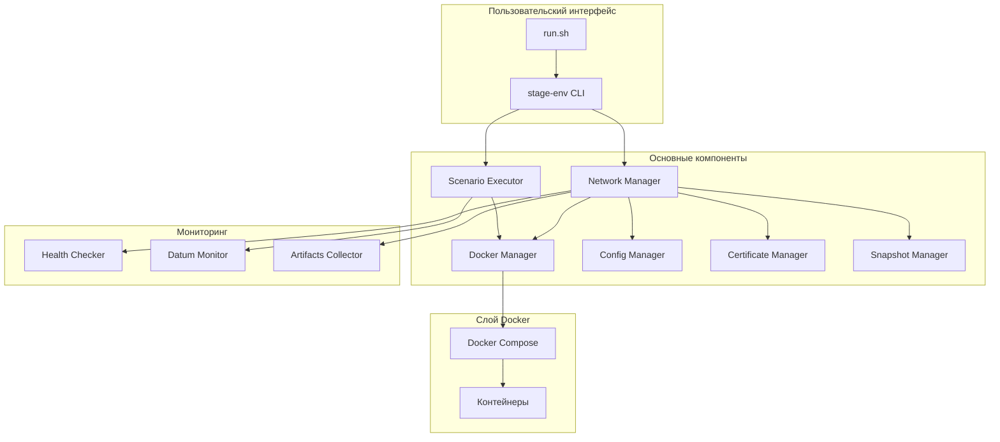
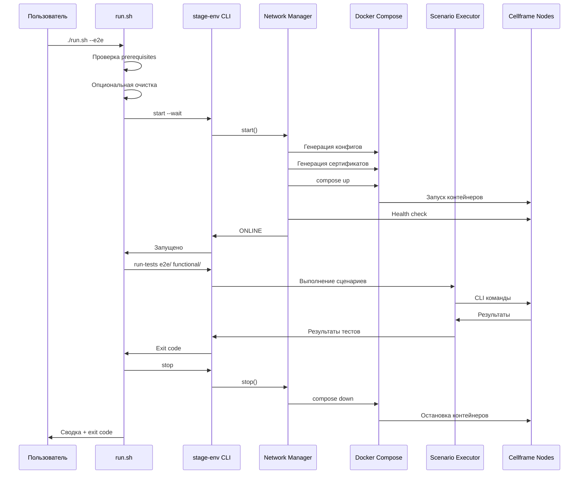

# Архитектура Stage Environment

**Внутренняя архитектура и компоненты тестовой системы stage-env**

---

## 📖 Содержание

1. [Обзор](#обзор)
2. [Архитектура системы](#архитектура-системы)
3. [Основные компоненты](#основные-компоненты)
4. [Поток данных](#поток-данных)
5. [Python модули](#python-модули)
6. [Реализация языка сценариев](#реализация-языка-сценариев)
7. [Интеграция с Docker](#интеграция-с-docker)
8. [Система snapshots](#система-snapshots)
9. [Мониторинг и здоровье](#мониторинг-и-здоровье)

---

## Обзор

Stage Environment - это Python-based CLI система для управления Docker-изолированными тестовыми средами Cellframe Node.

### Технологический стек

- **Язык:** Python 3.13+
- **CLI Framework:** Typer (построен на Click)
- **Контейнеризация:** Docker + Docker Compose V2
- **Валидация:** Pydantic 2.x
- **Логирование:** structlog
- **Async:** asyncio для асинхронных операций
- **HTTP Client:** httpx для RPC вызовов

### Ключевые принципы

1. **Автономность** - Полностью самодостаточная система
2. **Портируемость** - Легко переносится между окружениями
3. **Декларативность** - Тесты пишутся на YAML без программирования
4. **Изоляция** - Каждый тест/suite в чистом Docker окружении
5. **Fail-fast** - Ошибки должны быть явными, никаких молчаливых падений

---

## Архитектура системы



### Точки входа

#### 1. Bash-обёртка (`stage-env`)

**Назначение:** Активирует venv, устанавливает зависимости, запускает Python CLI

**Возможности:**
- Автоматическая установка зависимостей
- Управление виртуальным окружением
- Передача аргументов в Python CLI

#### 2. Python CLI (`stage_env.py`)

**Framework:** Typer

**Основные команды:**
- `start` - Запуск тестовой сети
- `stop` - Остановка сети
- `restart` - Перезапуск сети
- `status` - Показать статус сети
- `build` - Сборка cellframe-node артефактов
- `rebuild` - Пересборка Docker images и перезапуск
- `run-tests` - Выполнение YAML тестовых сценариев
- `logs` - Показать логи ноды
- `exec` - Выполнить команду в ноде
- `certs` - Генерация сертификатов
- `clean` - Очистка артефактов и кэша
- `pkgs-update` - Обновление пакетов в контейнерах
- `kill` - Корректная остановка (SIGTERM)
- `terminate` - Принудительная остановка (SIGKILL)
- `snapshots-list` - Список snapshots
- `snapshots-delete` - Удалить snapshot
- `snapshots-info` - Детали snapshot
- `snapshots-clean` - Очистить старые snapshots

**Модули команд:**
- `src/cli/network_commands.py`
- `src/cli/test_commands.py`
- `src/cli/cert_commands.py`
- `src/cli/snapshot_commands.py`

---

## Основные компоненты

### Network Manager

**Модуль:** `src/network/manager.py`  
**Класс:** `NetworkManager`

**Обязанности:**
- Управление жизненным циклом Docker Compose
- Создание/удаление сетевых топологий
- Генерация конфигураций нод
- Мониторинг health-check
- Интеграция со snapshot
- Управление логами и выполнение команд

**Ключевые методы:**
- `start()` - Запуск Docker Compose сети
- `stop()` - Остановка сети (опционально remove volumes)
- `restart()` - Перезапуск всей сети или конкретной ноды
- `rebuild()` - Полная пересборка (cleanup + build + start)
- `get_status()` - Получение статуса сети
- `generate_node_configs()` - Генерация NodeConfig для всех нод
- `create_clean_snapshot()` - Создание snapshot чистого состояния
- `restore_clean_state()` - Восстановление из snapshot
- `clean_test_data()` - Очистка user данных через docker exec
- `cleanup()` - Полная очистка (volumes, containers, artifacts)

**Версионирование Genesis:**

Genesis-сценарии организованы по мажорной версии Cellframe Node (`v5.x`, `v6.x`) в `scenarios/genesis/`. Метод `_detect_genesis_version()` автоматически определяет версию из имени DEB-пакета (например `cellframe-node-6.1-...` → `v6.x`). По умолчанию: `v6.x`.

### Scenario Executor

**Модуль:** `src/scenarios/executor.py`  
**Класс:** `ScenarioExecutor`

**Обязанности:**
- Выполнение CLI команд в Docker контейнерах
- Выполнение RPC вызовов
- Выполнение Python/Bash кода
- Управление RuntimeContext (переменные)
- Применение иерархических defaults
- Извлечение данных из вывода команд

**Поддерживаемые типы шагов:**
- `CLIStep` - команды cellframe-node-cli
- `ToolStep` - команды cellframe-node-tool
- `RPCStep` - JSON-RPC вызовы
- `PythonStep` / `PythonCheck` - Python код
- `BashStep` / `BashCheck` - Bash скрипты
- `WaitStep` - Простое ожидание
- `WaitForDatumStep` - Мониторинг lifecycle датумов
- `ConfigStep` - Модификации конфига
- `DockerOpStep` - Docker операции (start/stop/restart/pause/unpause/logs/exec/cp)
- `NetworkWaitStep` - Ожидание состояния сети
- `SnapshotStep` - Операции со snapshots
- `ForStep` - Циклы for с итерацией
- `IfStep` - Условное выполнение (if/then/else)
- `WhileStep` - Циклы while с максимумом итераций
- `SwitchStep` - Switch/case конструкции
- `SetStep` - Присваивание переменных
- `StepGroup` - Группировка шагов с локальными defaults (YAML ключ: `group:` или `name:`)

**Интеграция:**
- Использует `CLICommandParser` для автодобавления CLI опций
- Использует `DatumMonitor` для wait_for_datum
- Использует Docker client для exec команд

### Docker Compose Manager

**Модуль:** `src/docker/compose.py`  
**Класс:** `DockerComposeManager`

**Обязанности:**
- Управление docker-compose файлами
- Выполнение docker-compose команд
- Генерация docker-compose.yml из топологии
- Мониторинг статуса контейнеров
- Health checks и диагностика
- Регистрация root нод в сети

**Ключевые методы:**
- `build()` - Сборка Docker images
- `generate_compose_for_nodes()` - Генерация docker-compose.yml из NodeConfig[]
- `up()` - Запуск docker-compose up
- `down()` - Остановка (с опциями: volumes, images)
- `ps()` - Список контейнеров
- `logs()` - Получение логов контейнера
- `exec()` - Выполнение команды в контейнере
- `wait_for_services()` - Ожидание готовности всех нод
- `get_service_status()` - Статус всех сервисов
- `is_running()` - Проверка что сеть запущена
- `cleanup_stale_resources()` - Очистка старых контейнеров/сетей
- `add_extra_node_services()` - Добавление динамически создаваемых нод (из `node_compose`)
- `pause()` / `unpause()` - Приостановка/возобновление контейнеров (для имитации сбоев)

### Scenario Parser

**Модуль:** `src/scenarios/parser.py`  
**Класс:** `ScenarioParser`

**Обязанности:**
- Парсинг YAML сценариев
- Обработка includes (вложенных шаблонов)
- Валидация через Pydantic схемы
- Подстановка переменных

**Ключевые методы:**
- `parse_scenario()` - Парсинг одного файла сценария
- `parse_suite()` - Парсинг suite descriptor
- `_process_includes()` - Deep merge includes (поддерживает файловые пути и inline dict-записи)
- `substitute_variables()` - Замена {{var}} плейсхолдеров

### Certificate Generator

**Модуль:** `src/certs/generator.py`  
**Класс:** `CertGenerator`

**Обязанности:**
- Генерация node-addr.dcert для идентификации нод
- Генерация validator сертификатов для ROOT/MASTER нод
- Сборка Docker образа cert-generator
- Использование cellframe-node-tool

**Именование:**
- Node cert: `node-addr.dcert`
- Validator cert: `stagenet.master.pvt.{index}.dcert`
- Validator address: `validator_addr.txt`

**Хранение:** `/opt/cellframe-node/var/lib/ca/` (bind-mounted volume)

### Configuration Manager

**Модуль:** `src/config/loader.py`  
**Класс:** `ConfigLoader`

**Обязанности:**
- Загрузка stage-env.cfg
- Загрузка topology файлов
- Рендеринг Jinja2 шаблонов
- Валидация конфигураций

**Ключевые методы:**
- `load_stage_config()` - Загрузка stage-env.cfg в dict
- `load_topology()` - Загрузка и валидация топологии
- `render_template()` - Рендеринг Jinja2 шаблона
- `get_node_count()` - Подсчёт нод в топологии
- `list_topologies()` - Список доступных топологий

---

## Поток данных

### Поток выполнения тестов



---

## Python модули

### Структура директорий

```
src/
├── cli/                    # CLI команды
│   ├── network_commands.py  # start, stop, restart, status
│   ├── test_commands.py     # run-tests
│   ├── cert_commands.py     # certs
│   ├── snapshot_commands.py # snapshots
│   └── common.py            # Общие утилиты
│
├── scenarios/              # Система сценариев
│   ├── parser.py            # Парсинг YAML
│   ├── executor.py          # Движок выполнения
│   ├── schema.py            # Pydantic модели
│   ├── extractors.py        # Извлечение данных
│   ├── validator.py         # Pre-execution валидация
│   └── step/                # Исполнители шагов
│       ├── cli.py           # CLI step executor
│       ├── rpc.py           # RPC step executor
│       ├── python.py        # Python step executor
│       ├── bash.py          # Bash step executor
│       ├── wait.py          # Wait executor
│       └── wait_for_datum.py # Datum monitoring
│
├── network/                # Управление сетью
│   ├── manager.py           # NetworkManager
│   ├── topology_builder.py  # Построение топологии
│   ├── models.py            # NodeConfig, NetworkTopology
│   └── genesis*.py          # Инициализация genesis
│
├── docker/                 # Интеграция с Docker
│   ├── compose.py           # DockerComposeManager
│   └── container.py         # Операции с контейнерами
│
├── config/                 # Конфигурация
│   ├── loader.py            # ConfigLoader
│   ├── generator.py         # ConfigGenerator
│   └── manager.py           # ConfigManager
│
├── certs/                  # Сертификаты
│   └── generator.py         # CertGenerator
│
├── snapshots/              # Система snapshots
│   ├── manager.py           # SnapshotManager
│   ├── base.py              # BaseSnapshot
│   ├── recreate.py          # RecreateSnapshot
│   ├── filesystem.py        # FilesystemSnapshot
│   └── squashfs.py          # SquashfsSnapshot
│
├── monitoring/             # Мониторинг
│   ├── health.py            # HealthChecker
│   ├── datum.py             # DatumMonitor
│   ├── manager.py           # MonitoringManager
│   ├── artifacts.py         # ArtifactsCollector
│   └── waiter/              # Различные waiters
│
└── utils/                  # Утилиты
    ├── cli.py               # CLI helpers
    ├── logger.py            # Настройка логирования
    ├── cli_parser.py        # CLICommandParser
    ├── report_generator.py  # Генерация отчётов
    └── artifacts.py         # Управление артефактами
```

### Ключевые классы

#### ScenarioExecutor

**Назначение:** Выполнение тестовых сценариев пошагово

**Runtime Context:** Управляет переменными, результатами шагов, сводкой

**Паттерн выполнения шага:**
```python
def _execute_step(self, step, ctx: RuntimeContext, defaults):
    # 1. Объединить defaults
    effective_params = self._merge_defaults(step, defaults)
    
    # 2. Подставить переменные
    substituted = self._substitute_in_step(effective_params, ctx)
    
    # 3. Выполнить в зависимости от типа
    if isinstance(step, CLIStep):
        result = self._execute_cli_step(substituted, ctx)
    elif isinstance(step, WaitForDatumStep):
        result = self._execute_wait_for_datum_step(substituted, ctx)
    # ... и т.д.
    
    # 4. Сохранить результаты
    if step.save:
        ctx.set_variable(step.save, result)
    
    # 5. Применить wait
    if step.wait:
        self._wait_duration(step.wait)
```

#### DatumMonitor

**Назначение:** Фоновый сервис мониторинга lifecycle датумов

**Отслеживание lifecycle:**
1. **0.5s** - Проверка mempool (fail-fast если не найден)
2. **30-120s** - Ожидание включения в блок
3. **60-180s** - Ожидание распространения по сети

**Состояния:**
- `NOT_FOUND` → `REJECTED` (fail fast)
- `IN_MEMPOOL` → `VERIFIED` → `IN_BLOCKS` → `PROPAGATED`

**Параллелизм:** Может отслеживать несколько датумов одновременно

#### CLICommandParser

**Назначение:** Парсинг cellframe-node-cli help и автоприменение defaults

**Ключевые методы:**
- `parse_cli_help()` - Парсинг help из running контейнера
- `get_command_options()` - Получить доступные опции для команды
- `has_option()` - Проверить поддержку опции командой
- `apply_cli_defaults()` - Добавить отсутствующие опции из defaults.cli

**Кэш:** `cache/cli_commands.json`

**Пример:**
```python
# defaults.cli = {"net": "stagenet"}
# command = "token list"
# Результат: "token list -net stagenet" (если команда поддерживает -net)
```

#### SnapshotManager

**Назначение:** Быстрая изоляция test suites через snapshots

**Реализации:**
- **recreate** - Полная очистка и пересоздание (~40s)
- **filesystem** - rsync копирование (~3s create/restore)
- **squashfs** - Сжатые read-only образы (~2s restore, ~5s create)

**Преимущества:** Сокращает время изоляции suite с 40s до 2-3s

---

## Реализация языка сценариев

### Модели схем

**Модуль:** `src/scenarios/schema.py`

**Основные модели:**
- `TestScenario` - Полный тестовый сценарий
- `SuiteSetupScenario` - Легковесный suite setup
- `SuiteDescriptor` - Метаданные suite (включает `node_compose`, `node_compose_gen`, `docker_compose`)
- `NodeComposeSpec` - Динамическое определение ноды (id, role, source, packages, setup)
- `NodeComposeGenSpec` - Параметрический генератор нод (prefix, count с поддержкой `{{var}}`)
- `NetworkConfig` - Конфигурация сети
- `NodeConfig` - Конфигурация ноды
- `SectionConfig` - setup/test секции
- `CheckSectionConfig` - check секция
- `StepDefaults` - Иерархические defaults

**Типы шагов:**
- `CLIStep`, `ToolStep`, `RPCStep`
- `PythonStep`, `BashStep`
- `WaitStep`, `WaitForDatumStep`
- `ConfigStep`, `DockerOpStep` (start/stop/restart/pause/unpause/logs/exec/cp), `SnapshotStep`
- `NetworkWaitStep`
- Управление потоком: `ForStep`, `IfStep`, `WhileStep`, `SwitchStep`

**Типы проверок:**
- `CLICheck`, `RPCCheck`, `PythonCheck`, `BashCheck`

**Валидация:** Pydantic model validators для сложных проверок

### Извлечение данных

**Модуль:** `src/scenarios/extractors.py`  
**Класс:** `DataExtractor`

**Типы извлечения:**
- `wallet_address` - Cellframe wallet (base58, 75-105 символов)
- `node_address` - Node адрес (0x::формат)
- `hash` - Хэш (0x[hex]{64})
- `number` - Числовые значения
- `token_name` - Имя токена
- `bool` - Булевы значения
- `raw` - Произвольный тип

**Валидация:**
- `wallet_address`: Base58 decode + SHA3-256 checksum
- `node_address`: Проверка :: separator формата
- `hash`: Валидация 0x[hex]{64} паттерна

**Паттерны:**
```python
WALLET_ADDRESS_PATTERN = r'^[A-Za-z0-9]{75,105}$'
NODE_ADDRESS_PATTERN = r'^[A-Fa-f0-9:]{10,}$'
HASH_PATTERN = r'^(0x)?[A-Fa-f0-9]{64}$'
```

### Иерархические Defaults

**Уровни (приоритет от низкого к высокому):**
1. Глобальные (`defaults:` на верхнем уровне)
2. Секции (`setup:`, `test:`, `check:` могут иметь свои defaults)
3. Группы (`StepGroup` с локальными defaults)
4. Шаг (параметры конкретного шага)

**Правила merge:**
- Скалярные значения: Более конкретный уровень переопределяет
- `cli` dict: Deep merge (ключи добавляются/переопределяются)
- `None` значения в includes: Не переопределяют существующие

**Пример:**
```yaml
defaults:
  node: node1
  wait: 3s
  cli:
    net: stagenet

test:
  defaults:
    node: node2  # Переопределяет глобальный node
    cli:
      token: TEST  # Объединяется с глобальным cli.net
  steps:
    - cli: token list
      # Использует: node=node2, wait=3s, cli={net: stagenet, token: TEST}
```

---

## Интеграция с Docker

### Генерация Docker Compose

**Динамическая генерация:** `docker-compose.yml` создаётся из NodeConfig[]

**Шаблон ноды:**
```yaml
services:
  node-{id}:
    image: cf-node:debug-latest
    container_name: cellframe-stage-node-{id}
    hostname: node-{id}
    networks:
      stagenet:
        ipv4_address: {ip}
    ports:
      - "{http_port}:8079"
      - "{rpc_port}:8545"
    volumes:
      - ./data/node-{id}:/opt/cellframe-node/var/lib
      - ./config/node-{id}:/opt/cellframe-node/etc
    environment:
      - NODE_ID={id}
      - NODE_ROLE={role}
```

### Сеть

**Default subnet:** `172.20.0.0/16`  
**Base IP:** `172.20.0.10`  
**Выделение IP:** Последовательное (node-1: .10, node-2: .11, ...)

### Маппинг портов

**Базовые порты (настраиваемые):**
- HTTP: 8079
- RPC: 8545
- P2P: 31337
- CF: 7007

**Инкремент для нод:** node-{N} использует base_port + (N-1)

---

## Система Snapshots

### Обзор

**Назначение:** Быстрая изоляция test suites

**Преимущество:** Сокращает восстановление чистого состояния с 40s до 2-3s

**Документация:** `docs/snapshot_system.md`

### Реализации

#### Режим Recreate
**Скорость:** ~40s restore  
**Хранение:** Минимальное  
**Метод:** Полная очистка и перезапуск Docker

#### Режим Filesystem  
**Скорость:** ~3s create/restore  
**Хранение:** ~500MB  
**Метод:** rsync копирование директорий  
**Зависимости:** rsync

**Ключевые методы:**
- `_rsync_copy()` - Выполнение rsync с опциями
- `create()` - Копирование data/ в snapshot/
- `restore()` - Копирование snapshot/ в data/

#### Режим SquashFS
**Скорость:** ~2s restore, ~5s create  
**Хранение:** ~100MB сжатые  
**Метод:** Сжатые read-only образы + overlay  
**Зависимости:** squashfs-tools, overlayfs kernel support

**Ключевые методы:**
- `create()` - Создание .sqfs через mksquashfs
- `restore()` - Извлечение через unsquashfs + overlay mount

### Конфигурация

```ini
[suite_isolation]
mode = squashfs               # disabled/recreate/filesystem/squashfs
compression = gzip            # none/gzip/lzo/xz (для squashfs)
auto_create_on_startup = true # Создание clean_state при старте сети
auto_cleanup = true           # Автоудаление старых snapshots
keep_snapshot_count = 5       # Сколько хранить
```

---

## Мониторинг и здоровье

### Health Checker

**Модуль:** `src/monitoring/health.py`  
**Класс:** `HealthChecker`

**Проверки:**
- Доступность HTTP ноды (ping)
- Доступность CLI socket
- Отзывчивость RPC endpoint
- Анализ логов на ошибки

**Health status:**
```python
class HealthStatus:
    is_healthy: bool
    http_ok: bool
    cli_ok: bool
    rpc_ok: bool
    errors: List[str]
```

### Datum Monitor

**Модуль:** `src/monitoring/datum.py`  
**Класс:** `DatumMonitor`

**Назначение:** Фоновый сервис отслеживания lifecycle датумов

**Фазы мониторинга:**
1. **Mempool** (0.5s timeout) - Быстрое падение если отклонён
2. **Verification** (30-120s) - Ожидание включения в блок
3. **Propagation** (60-180s) - Ожидание синхронизации сети

**Использование в сценариях:**
```yaml
- cli: token_emit -token TEST -value 1000 -addr {{addr}} -certs test_cert
  save: tx_hash

- wait_for_datum: "{{tx_hash}}"
```

**Реализация:**
- Async monitoring loop
- Параллельное отслеживание нескольких датумов
- Future-based результаты
- Выполнение CLI команд для проверки статуса

### Artifacts Collector

**Модуль:** `src/monitoring/artifacts.py`  
**Класс:** `ArtifactsCollector`

**Собирает:**
- Логи нод (из контейнеров)
- Логи health check
- Core dumps
- Логи выполнения сценариев
- System info
- Метрики мониторинга

**Структура:**
```
artifacts/run_<timestamp>/
├── <test_type>/
│   └── <suite>/
│       ├── scenario-logs/
│       ├── node-logs/
│       ├── health-logs/
│       └── core-dumps/
└── summary.json
```

---

## Точки расширения

### Добавление нового типа шага

1. **Определить Pydantic модель** в `src/scenarios/schema.py`:
```python
class MyCustomStep(BaseModel):
    my_custom: str
    node: str = "node1"
```

2. **Добавить в TestStep Union:**
```python
TestStep = Union[CLIStep, ..., MyCustomStep]
```

3. **Реализовать executor** в `src/scenarios/step/my_custom.py`:
```python
class MyCustomStepExecutor:
    def execute(self, step: MyCustomStep, ctx: RuntimeContext):
        # Реализация
        pass
```

4. **Зарегистрировать в ScenarioExecutor:**
```python
def _execute_step(self, step, ctx, defaults):
    if isinstance(step, MyCustomStep):
        return self.my_custom_executor.execute(step, ctx)
```

### Добавление нового типа проверки

Тот же процесс, но используйте `CheckSpec` union вместо `TestStep`.

---

## См. также

- **[Руководство по Run.sh](RunShGuide.md)** - Пользовательское руководство по run.sh
- **[Tutorial по сценариям](scenarios/Tutorial.md)** - Изучение языка сценариев
- **[Glossary сценариев](scenarios/Glossary.md)** - Полный справочник DSL
- **Исходный код** - Python модули в `src/`

---

**Язык:** Русский | [English](../en/Architecture.md)

