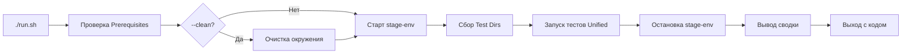

# Руководство по Run.sh - Унифицированный тестовый раннер для Cellframe Node

**Полное руководство по запуску E2E, Functional и Regression тестов**

---

## 📖 Содержание

1. [Обзор](#обзор)
2. [Быстрый старт](#быстрый-старт)
3. [Справочник команд](#справочник-команд)
4. [Типы тестов](#типы-тестов)
5. [Workflow](#workflow)
6. [Конфигурация](#конфигурация)
7. [Интеграция с CI/CD](#интеграция-с-cicd)
8. [Решение проблем](#решение-проблем)

---

## Обзор

`run.sh` - это унифицированный bash-скрипт для запуска всех типов тестов Cellframe Node. Он предоставляет единую точку входа для:

- **E2E тестов** - End-to-end сценарии в YAML
- **Functional тестов** - Тестирование отдельных команд
- **Regression тестов** - Воспроизведение багов

### Ключевые возможности

- ✅ **Унифицированное выполнение** - Все типы тестов в одном запуске
- ✅ **Автоматическое окружение** - Запускает/останавливает stage-env автоматически
- ✅ **Чистая изоляция** - Опциональная очистка перед тестами
- ✅ **Полные отчёты** - Сбор артефактов и сводки
- ✅ **Готовность к CI/CD** - Идеально для автоматизированных pipeline

### Расположение

```
cellframe-node/
└── tests/
    ├── run.sh              ← Этот скрипт
    ├── stage-env/          ← Тестовая инфраструктура
    ├── e2e/                ← E2E тест-сценарии
    ├── functional/         ← Functional тесты
    └── regression/         ← Regression тесты
```

---

## Быстрый старт

### Запуск всех тестов

```bash
cd tests
./run.sh
```

Это выполнит:
1. Запуск stage-env сети
2. Выполнение всех E2E, Functional и Regression тестов
3. Сбор артефактов
4. Остановку сети
5. Вывод сводки

### Запуск конкретного типа тестов

```bash
# Только E2E тесты
./run.sh --e2e

# Только functional тесты
./run.sh --functional

# Только regression тесты
./run.sh --regression
```

### Запуск конкретного test suite

```bash
# Один suite
./run.sh tests/e2e/token/

# Один сценарий
./run.sh tests/e2e/token/001_token_decl.yml

# Несколько suites
./run.sh tests/e2e/token/ tests/functional/wallet/
```

---

## Справочник команд

### Базовые команды

#### Запустить все тесты
```bash
./run.sh
```
- Запускает: E2E + Functional + Regression
- Автостарт сети
- Автостоп сети после тестов

#### Только E2E
```bash
./run.sh --e2e
```
- Тесты: `stage-env/tests/base/` + `e2e/`
- Применение: End-to-end валидация

#### Только Functional
```bash
./run.sh --functional
```
- Тесты: `functional/`
- Применение: Тестирование на уровне команд

#### Только Regression
```bash
./run.sh --regression
```
- Тесты: `regression/`
- Применение: Проверка исправленных багов

### Продвинутые опции

#### Очистка перед запуском
```bash
./run.sh --clean --e2e
```
- Очищает: cache, snapshots, volumes
- Применение: Свежее окружение, troubleshooting
- Примечание: НЕ пересобирает cellframe-node (только очищает тестовую среду)

#### Пересборка images
```bash
./run.sh --rebuild --e2e
```
- Пересобирает Docker images перед запуском
- Применение: После изменений в Dockerfile
- Примечание: Медленнее обычного старта

#### Остановка окружения
```bash
./run.sh --stop
```
- Только останавливает stage-env
- Не запускает тесты
- Применение: Очистка после прерванного теста

#### Обновление пакетов
```bash
./run.sh --pkgs-update
```
- Обновляет cellframe-node binary в контейнерах
- Запускает `apt update && apt upgrade`
- Применение: Тестирование с последними пакетами

#### Справка
```bash
./run.sh --help
```
- Показывает все доступные опции
- Предоставляет примеры использования

### Комбинирование опций

```bash
# Очистка, пересборка images, запуск E2E
./run.sh --clean --rebuild --e2e

# Запуск конкретного suite после очистки
./run.sh --clean tests/e2e/token/
```

---

## Типы тестов

### E2E тесты (`tests/e2e/`)

**Описание:** End-to-end сценарии, тестирующие полные workflow

**Формат:** YAML сценарии

**Пример структуры:**
```
tests/e2e/
├── token/
│   ├── 001_token_decl.yml
│   ├── 002_token_emit.yml
│   └── 003_token_transfer.yml
├── wallet/
│   ├── 001_wallet_create.yml
│   └── 002_wallet_operations.yml
└── chain/
    └── ...
```

**Включает:** Базовые тесты из `stage-env/tests/base/` (connectivity, health)

### Functional тесты (`tests/functional/`)

**Описание:** Тестирование отдельных команд и функций

**Формат:** YAML сценарии

**Фокус:** Поведение одной команды, edge cases

**Пример:**
```yaml
name: Команда Wallet List
description: Тест форматов вывода wallet list

test:
  - cli: wallet new -w test1
  - cli: wallet new -w test2
  - cli: wallet list
    contains: test1
    contains: test2
```

### Regression тесты (`tests/regression/`)

**Описание:** Воспроизведение багов

**Формат:** YAML сценарии

**Именование:** `test_bug_XXXXX.yml` (где XXXXX - номер issue)

**Цель:** Убедиться что исправленные баги не возвращаются

**Пример:**
```yaml
name: Bug #20138 - Валидация транзакций
description: Воспроизведение и проверка исправления issue #20138

test:
  # Шаги для воспроизведения бага
  - cli: ...
  
check:
  # Проверка что баг исправлен
  - cli: ...
    not_contains: "ERROR"
```

---

## Workflow

### Стандартный workflow



### Детальные шаги

#### 1. Проверка prerequisites
- Проверяет установку Python3
- Проверяет установку Docker
- Выходит при отсутствии

#### 2. Опциональная очистка (`--clean`)
- Запускает `stage-env clean --all`
- Удаляет snapshots (через Docker alpine)
- Очищает cache/data (через Docker alpine)
- Очищает cache/code (через Docker alpine)
- Удаляет .cache директорию

**Почему Docker alpine?** Файлы контейнеров принадлежат root, Docker cleanup избегает `sudo`

#### 3. Запуск сети
```bash
./stage-env --config=../stage-env.cfg start --wait
```
- Собирает images (если нужно)
- Генерирует конфиги
- Генерирует сертификаты
- Запускает контейнеры
- Ждёт пока все ноды станут ONLINE
- Создаёт clean_state snapshot (если настроено)

С `--rebuild`:
```bash
./stage-env --config=../stage-env.cfg start --rebuild --wait
```

#### 4. Сбор test директорий

**Логика сбора test директорий:**
```bash
TEST_DIRS=()

if [ указаны конкретные тесты ]; then
    # Использовать пути указанные пользователем
    TEST_DIRS=(пути_от_пользователя...)
else
    # Собрать по флагам типа
    if --e2e:
        TEST_DIRS+=(stage-env/tests/base/ e2e/)
    if --functional:
        TEST_DIRS+=(functional/)
    if --regression:
        TEST_DIRS+=(regression/)
fi
```

**Важно:** Пути конвертируются из корня `cellframe-node/` в относительные от `stage-env/`

**Пример конверсии:**
- Пользователь указывает: `tests/e2e/` (относительно cellframe-node/)
- Конвертируется в: `../e2e/` (относительно stage-env/)
- Используемый инструмент: `realpath --relative-to`

#### 5. Унифицированное выполнение тестов

**Один запуск со всеми директориями:**
```bash
./stage-env run-tests --no-start-network ${TEST_DIRS[@]}
```

**Преимущества:**
- Один `run_id` для всех тестов
- Единая директория `artifacts/`
- Унифицированный отчёт
- Сеть запускается один раз (быстрее)

#### 6. Остановка сети
```bash
./stage-env stop
```
- Останавливает все контейнеры
- Удаляет контейнеры
- Сохраняет volumes (если не указан `--volumes`)

#### 7. Сводка
- E2E Tests: PASSED/FAILED
- Functional Tests: PASSED/FAILED  
- Regression Tests: PASSED/FAILED
- Exit code: 0 если все прошли, 1 если хотя бы один упал

---

## Конфигурация

### Конфигурация Stage-env

**Расположение:** `tests/stage-env.cfg`

**Ключевые секции:**

```ini
[network]
name = stagenet
network_id = 0x1234
consensus_type = esbocs

[topology]
root_nodes_count = 3
master_nodes_count = 3
full_nodes_count = 1

[node_source]
type = local
local_path = ../test_build/cellframe-node.deb

[paths]
cache_dir = ../testing/cache
artifacts_dir = ../testing/artifacts

[timeouts]
startup = 600
health_check = 600
command = 30

[suite_isolation]
mode = squashfs
auto_create_on_startup = true
```

### Переменные окружения

#### STAGE_ENV_CONFIG
Переопределить расположение конфига:
```bash
STAGE_ENV_CONFIG=/path/to/my.cfg ./run.sh --e2e
```

#### DEBIAN_MIRROR
Использовать конкретный Debian mirror для Docker сборок:
```bash
DEBIAN_MIRROR=http://deb.debian.org/debian ./run.sh --rebuild --e2e
```

---

## Интеграция с CI/CD

### Пример GitLab CI

```yaml
test:e2e:
  stage: test
  script:
    - cd tests
    - ./run.sh --e2e
  artifacts:
    when: always
    paths:
      - tests/testing/artifacts/
    expire_in: 7 days
  only:
    - merge_requests
    - main
  timeout: 60m
```

### Пример GitHub Actions

```yaml
name: E2E Tests

on: [push, pull_request]

jobs:
  e2e:
    runs-on: ubuntu-latest
    timeout-minutes: 60
    
    steps:
      - uses: actions/checkout@v3
      
      - name: Запуск E2E тестов
        run: |
          cd tests
          ./run.sh --e2e
      
      - name: Загрузка артефактов
        if: always()
        uses: actions/upload-artifact@v3
        with:
          name: test-results
          path: tests/testing/artifacts/
```

### Лучшие практики для CI/CD

1. **Всегда используйте `--clean`** - Обеспечивает детерминированное окружение
2. **Устанавливайте timeout** - 30-60 минут в зависимости от количества тестов
3. **Собирайте artifacts при failure** - Используйте `when: always` или `if: always()`
4. **Кэшируйте Docker layers** - Ускоряет сборку images
5. **Разделяйте типы тестов** - E2E, Functional, Regression в отдельные jobs

---

## Решение проблем

### Частые проблемы

#### "Docker is required but not installed"

**Симптом:**
```
✗ Docker is required but not installed
```

**Решение:**
```bash
# Установить Docker
curl -fsSL https://get.docker.com | sh
sudo usermod -aG docker $USER
# Выйти и войти снова
```

#### "stage-env wrapper not found or not executable"

**Симптом:**
```
✗ stage-env wrapper not found or not executable
```

**Решение:**
```bash
chmod +x tests/stage-env/stage-env
```

#### "Permission denied" при очистке

**Симптом:**
```
rm: cannot remove 'testing/cache/data/...': Permission denied
```

**Решение:**
- run.sh автоматически использует Docker cleanup
- Убедитесь что Docker запущен: `sudo systemctl start docker`
- Ручная очистка: `./run.sh --clean`

#### "Port 8079 already in use"

**Симптом:**
```
Error starting userland proxy: listen tcp4 0.0.0.0:8079: bind: address already in use
```

**Решение:**
```bash
# Остановить другие процессы cellframe-node
pkill cellframe-node

# Или остановить stage-env
./run.sh --stop

# Или изменить порты в stage-env.cfg
```

#### Сеть уже запущена

**Симптом:**
```
Failed to start stage environment (network already exists)
```

**Решение:**
```bash
./run.sh --stop
./run.sh --e2e
```

#### Тесты зависают

**Симптом:**
- Тесты висят и не завершаются
- Нет вывода длительное время

**Отладка:**
```bash
# Проверить логи ноды
docker logs cellframe-stage-node-1

# Проверить статус сети
cd tests/stage-env
./stage-env status

# Follow логи
./stage-env logs node-1 --follow

# Проверить контейнеры
docker ps -a | grep cellframe-stage
```

### Команды отладки

```bash
# Проверить что запущено
docker ps

# Посмотреть артефакты
ls -la tests/testing/artifacts/

# Последний test run
ls -lt tests/testing/artifacts/ | head -n 2

# Просмотр summary
cat tests/testing/artifacts/<run_id>/summary.json | jq

# Просмотр логов сценария
cat tests/testing/artifacts/<run_id>/*/scenario-logs/*.log

# Логи ноды
cat tests/testing/artifacts/<run_id>/*/node-logs/node-1.log
```

### Советы по производительности

#### Быстрая итерация при разработке

При разработке тестов запустите сеть один раз и запускайте тесты многократно:

```bash
# Терминал 1: Запуск сети
cd tests/stage-env
./stage-env start --wait

# Терминал 2: Многократный запуск тестов (редактируйте и перезапускайте)
./stage-env run-tests ../e2e/my_test.yml

# По завершении (Терминал 1)
./stage-env stop
```

**Преимущество:** Старт сети занимает ~30-60s, но выполнение теста всего ~5-10s за run.

#### Быстрые CI сборки

```yaml
# GitLab CI - кэширование Docker layers
cache:
  key: docker-${CI_COMMIT_REF_SLUG}
  paths:
    - /var/lib/docker/

# Сборка один раз, тестирование многократно
stages:
  - build
  - test

build:
  script:
    - cd tests/stage-env
    - ./stage-env build

test:e2e:
  needs: [build]
  script:
    - cd tests
    - ./run.sh --e2e
```

---

## Продвинутое использование

### Запуск конкретных тестов

```bash
# Один сценарий
./run.sh tests/e2e/token/001_token_decl.yml

# Один suite
./run.sh tests/e2e/token/

# Несколько suites
./run.sh tests/e2e/token/ tests/e2e/wallet/

# Микс типов
./run.sh tests/e2e/token/ tests/functional/wallet/
```

### Кастомная конфигурация

```bash
# Использовать другой конфиг
STAGE_ENV_CONFIG=tests/custom.cfg ./run.sh --e2e

# Переопределить источник ноды
# Редактируйте tests/stage-env.cfg:
[node_source]
type = url
url = https://debian.pub.demlabs.net/public/pool/main/c/cellframe-node/cellframe-node_latest_amd64.deb
```

### Workflow разработки

```bash
# 1. Внести изменения в код
vim cellframe-sdk/dap-sdk/core/src/dap_common.c

# 2. Собрать локально (если используете local source)
cmake -B build && make -C build
cpack

# 3. Обновить stage-env.cfg для использования локальной сборки
[node_source]
type = local
local_path = build/cellframe-node_<version>_amd64.deb

# 4. Запустить тесты
cd tests
./run.sh --clean --e2e
```

---

## Exit коды

- **0** - Все тесты прошли
- **1** - Хотя бы один тип тестов упал

**Индивидуальное отслеживание:**
- E2E exit code отслеживается отдельно
- Functional exit code отслеживается отдельно
- Regression exit code отслеживается отдельно

**Пример сводки:**
```
════════════════════════════════════
 Test Results Summary
════════════════════════════════════
✓ E2E Tests: PASSED
✓ Functional Tests: PASSED
✗ Regression Tests: FAILED (exit code: 1)
════════════════════════════════════
```

Финальный exit code: **1** (потому что regression упал)

---

## Артефакты

После каждого запуска артефакты собираются в:

```
tests/testing/artifacts/run_<timestamp>/
├── e2e/
│   └── <suite_name>/
│       ├── scenario-logs/        # Логи выполнения сценария
│       ├── node-logs/            # Логи контейнеров
│       └── health-logs/          # Логи health check
├── functional/
│   └── ...
├── regression/
│   └── ...
├── reports/
│   ├── report.md                 # Markdown отчёт
│   └── report.pdf                # PDF отчёт (если pandoc доступен)
└── summary.json                  # JSON сводка
```

### Доступ к артефактам

```bash
# Последний run
cd tests/testing/artifacts/
ls -lt | head -n 2

# Просмотр summary
cat run_*/summary.json | jq

# Просмотр логов конкретного теста
cat run_*/e2e/token/scenario-logs/001_token_decl.log
```

---

## Интеграция со stage-env

`run.sh` - это обёртка над `stage-env` CLI:

### Взаимоотношение

```
run.sh
  ├── Парсинг аргументов
  ├── Проверка prerequisites
  ├── Опциональная очистка
  ├── → stage-env start --wait
  ├── → stage-env run-tests <dirs...>
  └── → stage-env stop
```

### Рабочая директория

**Критично:** run.sh переходит в директорию `stage-env/` перед вызовом stage-env:

```bash
pushd "$SCRIPT_DIR/stage-env" > /dev/null
./stage-env --config="$STAGE_ENV_CONFIG_ABS" start --wait
popd > /dev/null
```

**Зачем?** Относительные пути в `stage-env.cfg` работают корректно:
```ini
[paths]
cache_dir = ../testing/cache      # Относительно stage-env/
```

### Резолюция пути конфига

run.sh конвертирует конфиг в абсолютный путь для безопасности:

```bash
STAGE_ENV_CONFIG_ABS="$(cd "$(dirname "$STAGE_ENV_CONFIG")" && pwd)/$(basename "$STAGE_ENV_CONFIG")"
```

Это гарантирует что конфиг работает независимо от текущей директории.

---

## См. также

- **[README Stage-env](README.md)** - Основная документация
- **[Tutorial по сценариям](scenarios/Tutorial.md)** - Изучение языка сценариев
- **[Архитектура](Architecture.md)** - Внутреннее устройство системы

---

**Язык:** Русский | [English](../en/RunShGuide.md)

